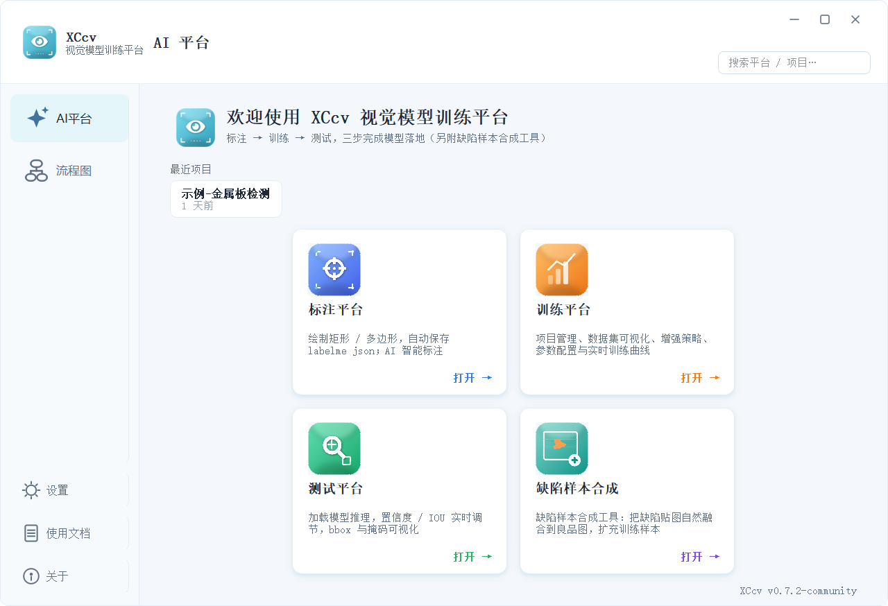

# XCcv Community — Deep Learning Vision Model Training Platform (Community Edition)

[](https://github.com/Arbhh/XCcv_community/actions/workflows/ci.yml)

[中文](README.md) | English

XCcv Community is the community edition of an **offline desktop** deep learning model training
platform for industrial vision scenarios. It covers the full pipeline of **data annotation →
model training → testing & evaluation**, plus a **defect sample synthesis** tool.
A first-time user can take a vision model from raw data to trained weights entirely through the
desktop UI, running fully offline so data never leaves the local network.
The UI supports **one-click Chinese / English switching** (in the workbench "Settings" dialog;
applies across the whole platform).



> Workbench: Annotate → Train → Test in three steps, plus defect sample synthesis and a
> flowchart orchestration module.

## Feature Overview

| Module | Capabilities |
|---|---|
| Annotation | Integrated labelme annotator: rectangles / polygons, autosave, class management; **AI-assisted annotation** (S smart polygon, B brush shaping, L single-image smart annotation, folder batch pre-annotation, based on SAM / EfficientSAM); OK/good-part folder badges, annotation quality tips, AI review of suspected missed labels |
| Training | Project-based management; **5 task types, 12 built-in models** (classification / detection / segmentation / unsupervised anomaly detection PatchCore / OCR CRNN, incl. ResNet / MobileNetV3 / YOLO11 / Faster R-CNN / Mask R-CNN); quick-config and expert-mode dual-track parameters; industrial optimizations (CBAM/ECA, DCNv2, Focal-family losses); training accelerations (frozen backbone, AMP, TF32, early stop, grayscale, deterministic runs); P2 small-object head, negative-sample training, tiling training; per-class metrics table, data grid, split donut chart redrawn live with parameters, real-time preview of all augmentation operators, loss diagnosis, run manifest, data health check, multi-run comparison |
| Testing | Single-image / batch inference; live confidence and IOU threshold tuning; class filtering; 4K tiled inference; unified JSON / labelme / COCO export; **Standard / Project Review dual pages** (auto batch over the training set; the review page decouples **Evaluated / Unevaluated** — evaluated images group into Correct / Missed / Over-kill, unevaluated production images group into OK / NG); dimension threshold dragging and typing (confidence / area / short side / long side / gray difference; sweep curves show the image count per group at the threshold, same semantics as the groups; curves switch semantics with the scope); review reflow; model A/B comparison (cached results + overall verdict bar); latency / VRAM statistics |
| Flowchart | A standalone module at the same level as the AI platform: **39 AI & common operators** built in (model inference / detection filtering / crop & merge / per-image execution / result merge / logic verdict / output); drag-and-drop web canvas, node library split into "AI operators / Common operators"; run preview, save JSON, pack / unpack `.xvap`, batch runs; 4 templates (AI filter, cascade crop-merge, detection→segmentation cascade, detection→crop→classification cascade) |
| Defect Sample Synthesis | Blends defect patches onto good-part images with Poisson fusion to expand scarce defect samples (separate process with an embedded web UI) |
| UI Language | **One-click Chinese / English switching**: choose in the workbench "Settings" dialog; the whole platform switches automatically; resident UI texts and frequent messages are translated (see this document); some settings dialogs and the defect synthesis tool are not yet localized and will be covered in later releases |

> The flowchart module supports visual orchestration of AI and common operators
> (39 nodes / 4 templates), covering model inference, detection filtering, crop & merge,
> logic verdicts and result output for common production lines.

## Requirements

- Windows 10 / 11 (x64)
- Python 3.11 (a dedicated virtual environment is recommended)
- GPU: optional. An NVIDIA GPU greatly speeds up training and inference; CPU also works
  (small models recommended)
- Disk: dependencies (PyTorch etc.) need about 6–8 GB

## Installation

```bat
:: 1) Create and activate a virtual environment (Python 3.11)
python -m venv venv
venv\Scripts\activate

:: 2) Install PyTorch (pick CUDA / CPU from the official index; CUDA 12.8 shown)
pip install torch torchvision --index-url https://download.pytorch.org/whl/cu128

:: 3) Install the remaining dependencies
pip install -r requirements.txt
```

## Quick Start

> **Launcher environment (important)**: the workbench, flow canvas and defect synthesis all
> depend on PyQtWebEngine. The `run_*.bat` scripts are pure-ASCII and **do not require a venv
> in this folder**; they probe candidates in this order (the only criterion is whether
> `import PyQt5.QtWebEngineWidgets` succeeds):
>
> 1. the `XCCV_PY` environment variable;
> 2. `python_path.txt` in this folder (one line: full path to python.exe);
> 3. `python` on PATH;
> 4. the `py` launcher (`py -3`);
> 5. `C:\XCcv\venv` (the product environment's conventional location, if present and usable);
> 6. `venv` / `.venv` in this folder (optional fallback).
>
> If none works, the scripts print English guidance and run `tools\env_check.py` for a detailed
> diagnosis. It is recommended to write one line into `python_path.txt` on the target machine,
> e.g. `C:\XCcv\venv\Scripts\python.exe` (the file is gitignored; it may differ per machine).

Double-click `run_main.bat` (or `python -m xccv.app`) to open the workbench, then enter each
platform from its card:

1. **Annotate**: create a project → import images → draw rectangles / polygons
   (optionally press S for AI-assisted polygons);
2. **Train**: pick the project and model (classification / detection / segmentation /
   anomaly detection / OCR) → quick config or expert mode → start training with live curves
   and per-class metrics;
3. **Test**: load the project's latest model (best.pt) → single-image / batch inference →
   results on the Standard page, or switch to the "Project Review" page: tune thresholds under
   "Evaluated" (Correct / Missed / Over-kill), then switch to "Unevaluated" to check production
   images as OK / NG; review reflow and A/B comparison supported;
4. **Flowchart** (same-level module in the left navigation): pick the data path and a flow
   JSON → "Run Flow" for single-image results, or "Edit Flow" to orchestrate AI / common
   operators on the canvas, pack as `.xvap` and run batches;
5. **Defect Sample Synthesis** (optional): enter from the workbench card to expand the
   training set;
6. **UI Language**: workbench "Settings" → "Language" → English; all platform windows switch
   automatically after saving.

Command-line entries (equivalent to the workbench cards):

```bat
run_annotation.bat   :: Annotation platform
run_training.bat     :: Training platform
run_testing.bat      :: Testing platform
run_flow.bat         :: Flowchart (standalone window; also in the left navigation)
run_defectgen.bat    :: Defect sample synthesis
```

For the detailed getting-started guide see
[docs/quickstart_EN.md](docs/quickstart_EN.md) (中文: [docs/quickstart.md](docs/quickstart.md));
for the full project introduction (positioning, feature details, architecture, compliance) see
the appendix [docs/XCcv社区版_项目简介.docx](docs/XCcv社区版_项目简介.docx) (Chinese).

### Optional: AI annotation weights

AI-assisted annotation (smart polygon / brush / smart annotation / batch pre-annotation)
needs SAM-family weights, which are not distributed with this repository. Please obtain them
from the official channels (e.g. `sam2.1_t.pt`, `mobile_sam.pt`), follow each weight's license
terms, and place them under `weights/sam/` in the repository root. When missing, the affected
features show clear guidance and everything else keeps working.

## Repository Layout

```
XCcv-Community/
├── xccv/                # Main package (workbench / annotation / training / testing /
│   │                    #   defect synthesis / engine)
│   ├── annotation/      #   Annotation platform (labelme host + AI-assisted annotation)
│   ├── training/        #   Training platform
│   ├── testing/         #   Testing platform
│   ├── defectgen/       #   Defect sample synthesis (FastAPI + embedded web)
│   ├── flow_platform.py #   Flowchart page (same level as AI platform; image tree / run / batch)
│   ├── modeltools/      #   Flow canvas host (QtWebEngine + LiteGraph), flow session & templates
│   ├── engine/          #   Pure-logic engine (data pipeline / model registry / metrics /
│   │   └── flow/        #     result contracts; flow engine: typed-port IR / executor / 39 ops)
│   └── assets/          #   Icons
├── labelme/             # vendored labelme 5.8.1 (GPLv3, with local modifications,
│                        #   see labelme/MODIFICATIONS.md)
├── docs/                # Quick start / project introduction / images
├── licenses/            # License texts (AGPL-3.0 / labelme GPLv3)
├── requirements.txt
└── run_*.bat            # Per-platform launch scripts
```

Runtime data (projects, logs, preferences) is generated under `platform_data/` and is not
distributed with the repository.

## License

- This project's code is released under the **GNU Affero General Public License v3.0
  (AGPL-3.0)**, see [LICENSE](LICENSE).
- The `labelme/` directory is a vendored copy of labelme 5.8.1 with local modifications,
  under **GPLv3**; see
  [licenses/labelme-LICENSE-GPLv3.txt](licenses/labelme-LICENSE-GPLv3.txt).
- ultralytics (YOLO11 / SAM) used in the training pipeline is **AGPL-3.0**; for closed-source
  commercial use, please evaluate its enterprise licensing yourself.
- Third-party dependency list and notices: [THIRD_PARTY_NOTICES.md](THIRD_PARTY_NOTICES.md).

## Disclaimer

This project is provided "as is", without warranty of any kind, express or implied. Before
deploying models trained with this tool to production, perform your own thorough validation.
